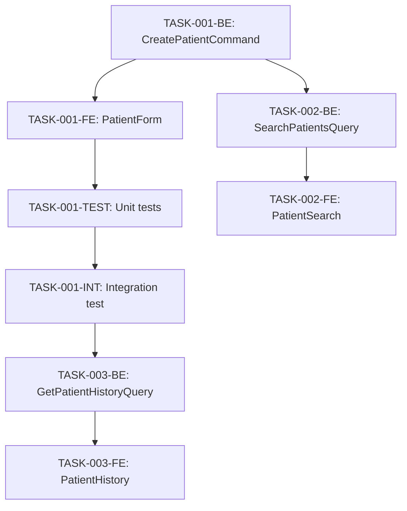

# 14. Implementation Roadmap

**Document Status:** ✅ Complete  
**Last Updated:** 2026-10-21  
**Owner:** Planning Phase  
**Related Documents:** [03-product-scope.md](./03-product-scope.md), [06-architecture-decisions.md](./06-architecture-decisions.md), [15-traceability-matrix.md](./15-traceability-matrix.md)

---

## 1. Overview

### 1.1 Purpose
Define phased implementation plan with milestones, task dependencies, success criteria, and timeline for ClinicCare development from Milestone 0 (current) to v2.0.

### 1.2 Current State
**Milestone 0: Foundation Complete** ✅
- Clean Architecture scaffold (Domain, Application, Infrastructure, API layers)
- Authentication & authorization (JWT, role-based)
- Database context (ApplicationDbContext, Identity integration)
- API structure (Minimal APIs, MediatR)
- Frontend scaffold (React, Vite, Tailwind, Shadcn/ui)
- Login/logout functionality working
- No clinical features implemented yet

### 1.3 Delivery Philosophy
- **Incremental:** Deliver functional features every 2-3 weeks
- **Vertical Slices:** Complete end-to-end workflows (backend + frontend + tests)
- **Risk-First:** Tackle highest-risk features early (financial accuracy, data integrity)
- **User Feedback:** Demo after each milestone, adjust priorities

---

## 2. Release Plan

| Version | Target Date | Focus | Status |
|---------|-------------|-------|--------|
| **v0.1 (M0)** | ✅ Complete | Foundation | ✅ Done |
| **v1.0 (M1)** | Week 24 | Core workflows (Patient, Queue, Billing) | 🔵 Planning |
| **v1.1 (M2)** | Week 48 | Clinical features, Multi-branch | 🔵 Planned |
| **v1.2 (M3)** | Week 60 | Reports, Enhancements | 🔵 Planned |
| **v2.0 (M4)** | Week 96 | Advanced features, PostgreSQL | 🔵 Planned |

**⚠️ Timeline Note:** Based on 121 person-days effort estimate (see 08-effort-estimation.md), realistic delivery for solo developer is 24 weeks for v1.0 (assuming ~5 productive days/week = 120 days ÷ 5 = 24 weeks). Original 8-week estimate required 3-person team.

---

## 3. Milestone 1: Core Clinical Workflows (v1.0)

### 3.1 Objectives
Deliver minimum viable clinic management system with:
- Patient registration and management
- Appointment scheduling and queue
- Basic consultation workflow
- Billing and cash drawer management
- Single-branch operation

**Target Date:** Week 24 (24 weeks from planning complete, solo developer)  
**Success Criteria:**
- ✅ Doctor can register patient, create appointment, complete consultation, generate invoice, record payment
- ✅ Receptionist can manage queue, call patients, record payments
- ✅ Admin can create users and configure branch settings
- ✅ All critical path tests passing (≥80% coverage)
- ✅ Zero high-severity bugs

### 3.2 Feature Breakdown

#### Sprint 1 (Weeks 1-2): Foundation & Patient Management
**Epic:** Test Infrastructure & Patient Registration

**Week 1: Infrastructure Setup**
Before implementing clinical features, establish test infrastructure, CI/CD, and deployment configuration to ensure quality gates are in place.

**Foundation Tasks:**
- **TASK-000-INFRA:** Test infrastructure setup
  - Backend test projects (xUnit, FluentAssertions)
  - Frontend test setup (Vitest, Testing Library, jest-axe)
  - Sample tests demonstrating patterns
  - CI/CD pipeline (GitHub Actions)
  - Coverage enforcement (≥80% backend, ≥70% frontend)
  - Estimate: 1 day
  - Priority: P0 (blocks all feature work)

- **TASK-000-DB:** Database test infrastructure
  - In-memory database for integration tests
  - Test data seeding utilities
  - Database cleanup between tests
  - Estimate: 0.5 day
  - Priority: P0

- **TASK-000-AUTH:** Authentication test utilities
  - Mock JWT token generation for tests
  - Test user fixtures (admin, doctor, receptionist)
  - Authorization test helpers
  - Estimate: 0.5 day
  - Priority: P0

- **TASK-000-LAN:** LAN deployment configuration
  - Docker Compose internet-independent setup (0.0.0.0:5000 binding)
  - CORS configuration for LAN IP addresses
  - Network troubleshooting documentation
  - Static IP setup guide
  - Estimate: 1 day
  - Priority: P0

**Week 1 Deliverables:**
- [ ] Complete test infrastructure (backend + frontend)
- [ ] CI/CD pipeline running on every commit
- [ ] Code coverage reporting configured
- [ ] LAN deployment tested and documented
- [ ] Foundation blocks Sprint 1 Week 2 clinical work

---

**Week 2: Patient Management Features**

**User Stories:**
1. **US-001:** As a receptionist, I can register a new patient with demographics, so they can be scheduled for appointments.
   - Acceptance Criteria:
     - Form validates required fields (firstName, lastName, phone, dateOfBirth)
     - Duplicate phone number detection warns user
     - Patient appears in patient list after creation
     - Audit log records who created patient
   - Tasks:
     - [ ] TASK-001-BE: Implement `CreatePatientCommand` handler
     - [ ] TASK-001-FE: Build `PatientForm` component with validation
     - [ ] TASK-001-TEST: Unit tests for validation rules
     - [ ] TASK-001-INT: Integration test for patient creation API
   - Estimate: 3 days
   - Priority: P0 (blocker)

2. **US-002:** As a receptionist, I can search for patients by name/phone/national ID, so I can quickly find existing patients.
   - Acceptance Criteria:
     - Search results appear within 300ms
     - Autocomplete shows top 10 matches
     - Search by name, phone, or national ID
     - Clicking result navigates to patient profile
   - Tasks:
     - [ ] TASK-002-BE: Implement `SearchPatientsQuery` with fuzzy matching
     - [ ] TASK-002-FE: Build `PatientSearch` autocomplete component
     - [ ] TASK-002-TEST: Test search accuracy and performance
   - Estimate: 2 days
   - Priority: P0

3. **US-003:** As a doctor, I can view patient visit history, so I can understand their medical background.
   - Acceptance Criteria:
     - Visit history shows date, diagnosis, medications
     - Paginated (20 per page)
     - Sorted by date descending (most recent first)
   - Tasks:
     - [ ] TASK-003-BE: Implement `GetPatientVisitHistoryQuery`
     - [ ] TASK-003-FE: Build `PatientHistory` component
     - [ ] TASK-003-TEST: Test pagination and sorting
   - Estimate: 2 days
   - Priority: P1

**Sprint 1 Deliverables:**
- [ ] Patient CRUD operations (create, read, update)
- [ ] Patient search with autocomplete
- [ ] Patient profile page with visit history
- [ ] 15+ unit tests, 5+ integration tests

**Sprint 1 Risks:**
- ⚠️ Duplicate patient detection logic complex (national ID optional, phone can change)
- Mitigation: Use phone as primary unique identifier, warn on duplicate but allow override

---

#### Sprint 2 (Weeks 3-4): Appointment & Queue Management
**Epic:** Scheduling & Queue Workflow

**User Stories:**
4. **US-004:** As a receptionist, I can schedule an appointment for a patient, so they are added to the queue.
   - Acceptance Criteria:
     - Appointment requires patient, branch, date/time, type (walkin/scheduled)
     - Creates both Appointment and QueueToken
     - Conflict detection warns if patient has existing appointment same day
     - Appointment appears in calendar view (P2 feature, table view for v1.0)
   - Tasks:
     - [ ] TASK-004-BE: Implement `CreateAppointmentCommand`
     - [ ] TASK-004-FE: Build `AppointmentForm` component
     - [ ] TASK-004-TEST: Test conflict detection logic
   - Estimate: 3 days
   - Priority: P0

5. **US-005:** As a receptionist, I can view today's queue, so I know which patients are waiting.
   - Acceptance Criteria:
     - Queue shows token number, patient name, wait duration, status
     - Real-time updates (polling every 10 seconds)
     - Filtered by branch (if user has multi-branch access)
     - Color-coded status badges (waiting=orange, in-progress=blue, completed=green)
   - Tasks:
     - [ ] TASK-005-BE: Implement `GetQueueStatusQuery`
     - [ ] TASK-005-FE: Build `QueueDashboard` component with polling
     - [ ] TASK-005-TEST: Test queue ordering logic
   - Estimate: 3 days
   - Priority: P0

6. **US-006:** As a receptionist, I can call the next patient in queue, so they know it's their turn.
   - Acceptance Criteria:
     - "Call Next" button calls next waiting token
     - Previous called token moves to in-progress
     - Token status updates in real-time
     - Cannot call next if no waiting tokens (button disabled)
   - Tasks:
     - [ ] TASK-006-BE: Implement `CallNextTokenCommand`
     - [ ] TASK-006-FE: Build `QueueControls` component
     - [ ] TASK-006-TEST: Test state transitions
   - Estimate: 2 days
   - Priority: P0

7. **US-007:** As a receptionist, I can mark a patient as no-show, so the queue stays accurate.
   - Acceptance Criteria:
     - Mark token as no-show with optional note
     - No-show tokens removed from active queue
     - Audit log records who marked no-show
   - Tasks:
     - [ ] TASK-007-BE: Implement `MarkTokenNoShowCommand`
     - [ ] TASK-007-FE: Add "No-Show" action to QueueCard
     - [ ] TASK-007-TEST: Test no-show workflow
   - Estimate: 1 day
   - Priority: P1

**Sprint 2 Deliverables:**
- [ ] Appointment creation with queue integration
- [ ] Queue dashboard with real-time updates
- [ ] Queue controls (call next, mark no-show, skip)
- [ ] 12+ unit tests, 4+ integration tests, 1 e2e test (queue workflow)

**Sprint 2 Risks:**
- ⚠️ Race condition if two users call next simultaneously
- Mitigation: Database transaction + optimistic concurrency (row versioning)

---

#### Sprint 3 (Weeks 5-6): Consultation Workflow
**Epic:** Clinical Consultation & Documentation

**User Stories:**
8. **US-008:** As a doctor, I can start a consultation for a patient, so I can document their visit.
   - Acceptance Criteria:
     - Creates Encounter entity linked to patient and appointment
     - Marks queue token as in-progress
     - Only one active encounter per patient
     - Encounter includes chief complaint, start time
   - Tasks:
     - [ ] TASK-008-BE: Implement `StartConsultationCommand`
     - [ ] TASK-008-FE: Build consultation entry point (from queue or patient profile)
     - [ ] TASK-008-TEST: Test single active encounter constraint
   - Estimate: 2 days
   - Priority: P0

9. **US-009:** As a doctor, I can record vitals (BP, temp, pulse, weight), so I have objective data.
   - Acceptance Criteria:
     - Quick vitals form with validation (ranges: BP 80-200/50-120, temp 35-42°C)
     - Vitals stored as Observation entities
     - Vitals displayed in consultation workspace
   - Tasks:
     - [ ] TASK-009-BE: Implement `RecordVitalsCommand`
     - [ ] TASK-009-FE: Build `VitalsForm` component
     - [ ] TASK-009-TEST: Test validation rules
   - Estimate: 2 days
   - Priority: P1

10. **US-010:** As a doctor, I can write clinical notes (SOAP format), so I document my assessment.
    - Acceptance Criteria:
      - Autosave every 5 seconds (draft stored locally)
      - SOAP sections: Subjective, Objective, Assessment, Plan
      - Rich text editor (P2), plain text for v1.0
    - Tasks:
      - [ ] TASK-010-BE: Implement `UpdateEncounterNotesCommand`
      - [ ] TASK-010-FE: Build `ClinicalNotesEditor` with autosave
      - [ ] TASK-010-TEST: Test autosave and recovery
    - Estimate: 3 days
    - Priority: P0

11. **US-011:** As a doctor, I can add diagnosis with ICD-10 codes, so visits are properly coded.
    - Acceptance Criteria:
      - ICD-10 code search (typeahead on common ~500 codes)
      - Can enter custom diagnosis if code not found
      - Primary diagnosis indicator
      - Multiple diagnoses supported
    - Tasks:
      - [ ] TASK-011-BE: Implement `AddDiagnosisCommand`, seed ICD-10 codes
      - [ ] TASK-011-FE: Build `DiagnosisSearch` component
      - [ ] TASK-011-TEST: Test ICD-10 search accuracy
    - Estimate: 3 days
    - Priority: P1

12. **US-012:** As a doctor, I can prescribe medications, so patient knows their treatment plan.
    - Acceptance Criteria:
      - Medication order with: name, dosage, frequency, duration, quantity, instructions
      - Free-text medication name (no drug database v1.0)
      - Instructions printed on prescription (P2 feature)
    - Tasks:
      - [ ] TASK-012-BE: Implement `CreateMedicationOrderCommand`
      - [ ] TASK-012-FE: Build `MedicationOrderForm` component
      - [ ] TASK-012-TEST: Test order validation
    - Estimate: 2 days
    - Priority: P0

13. **US-013:** As a doctor, I can complete a consultation, so it's finalized and invoiced.
    - Acceptance Criteria:
      - Marks encounter as completed (immutable)
      - Marks queue token as completed
      - Automatically creates invoice with consultation fee
      - Optional follow-up date
    - Tasks:
      - [ ] TASK-013-BE: Implement `CompleteConsultationCommand`
      - [ ] TASK-013-FE: Add "Complete" button to consultation workspace
      - [ ] TASK-013-TEST: Test encounter immutability after completion
    - Estimate: 2 days
    - Priority: P0

**Sprint 3 Deliverables:**
- [ ] Consultation workspace (vitals, notes, diagnosis, medications)
- [ ] Encounter lifecycle (start, update, complete)
- [ ] ICD-10 code integration (~500 common codes)
- [ ] Medication ordering
- [ ] 18+ unit tests, 6+ integration tests, 1 e2e test (consultation workflow)

**Sprint 3 Risks:**
- ⚠️ Autosave conflicts if doctor edits on multiple devices (unlikely in v1.0)
- Mitigation: Single-tab usage assumption, add multi-tab detection in v1.1
- ⚠️ ICD-10 code database size (20K codes = 5MB)
- Mitigation: Start with 500 common codes, expand in v1.1

---

#### Sprint 4 (Weeks 7-8): Billing & Cash Drawer
**Epic:** Financial Management

**User Stories:**
14. **US-014:** As a receptionist, I can create an invoice for a patient, so they can be charged.
    - Acceptance Criteria:
      - Line items: description, quantity, unit price, tax rate
      - Discount (percentage or fixed amount)
      - Auto-calculation of subtotal, tax, total
      - Invoice number auto-generated (INV-YYYY-NNNNNN)
    - Tasks:
      - [ ] TASK-014-BE: Implement `CreateInvoiceCommand`
      - [ ] TASK-014-FE: Build `InvoiceForm` with dynamic line items
      - [ ] TASK-014-TEST: Test calculation accuracy (edge cases: rounding, zero amount)
    - Estimate: 3 days
    - Priority: P0

15. **US-015:** As a receptionist, I can record a payment against an invoice, so I track money received.
    - Acceptance Criteria:
      - Payment methods: cash, card, insurance
      - If cash, must select active cash drawer
      - Updates invoice status (pending → partial → paid)
      - Updates cash drawer balance if cash payment
      - Cannot overpay invoice
    - Tasks:
      - [ ] TASK-015-BE: Implement `RecordPaymentCommand`
      - [ ] TASK-015-FE: Build `PaymentForm` component
      - [ ] TASK-015-TEST: Test payment validation and balance updates
    - Estimate: 3 days
    - Priority: P0

16. **US-016:** As a receptionist, I can open cash drawer at start of shift, so I track daily cash.
    - Acceptance Criteria:
      - Only one open drawer per branch
      - Records opening balance and opened by user
      - Cannot record cash payments without open drawer
    - Tasks:
      - [ ] TASK-016-BE: Implement `OpenCashDrawerCommand`
      - [ ] TASK-016-FE: Build `CashDrawerControl` component
      - [ ] TASK-016-TEST: Test single-drawer constraint
    - Estimate: 2 days
    - Priority: P0

17. **US-017:** As a receptionist, I can record expenses from cash drawer, so I track money going out.
    - Acceptance Criteria:
      - Expense: amount, category, description, notes
      - Deducts from cash drawer balance
      - Categories: supplies, utilities, maintenance, salaries, other
    - Tasks:
      - [ ] TASK-017-BE: Implement `RecordExpenseCommand`
      - [ ] TASK-017-FE: Build `ExpenseForm` component
      - [ ] TASK-017-TEST: Test expense recording
    - Estimate: 2 days
    - Priority: P0

18. **US-018:** As a receptionist, I can close cash drawer at end of shift, so I reconcile daily cash.
    - Acceptance Criteria:
      - Enter closing balance (actual cash counted)
      - System calculates expected balance (opening + payments - expenses)
      - Shows discrepancy if |actual - expected| > 5.00
      - Drawer cannot be reopened after closing
    - Tasks:
      - [ ] TASK-018-BE: Implement `CloseCashDrawerCommand`
      - [ ] TASK-018-FE: Build cash drawer reconciliation UI
      - [ ] TASK-018-TEST: Test reconciliation calculations
    - Estimate: 2 days
    - Priority: P0

19. **US-019:** As an admin, I can view cash drawer history, so I audit daily reconciliations.
    - Acceptance Criteria:
      - Filtered by branch and date range
      - Shows opening/closing balance, discrepancies
      - Drill-down into transactions (payments, expenses)
    - Tasks:
      - [ ] TASK-019-BE: Implement `GetCashDrawerHistoryQuery`
      - [ ] TASK-019-FE: Build `CashDrawerHistory` page
      - [ ] TASK-019-TEST: Test filtering and pagination
    - Estimate: 2 days
    - Priority: P1

**Sprint 4 Deliverables:**
- [ ] Invoice creation and management
- [ ] Payment recording (cash, card, insurance)
- [ ] Cash drawer lifecycle (open, record transactions, close, reconcile)
- [ ] Expense tracking
- [ ] 15+ unit tests, 5+ integration tests, 1 e2e test (billing workflow)

**Sprint 4 Risks:**
- ⚠️ Financial calculations must be precise (no floating-point errors)
- Mitigation: Use `decimal` type for all money values, test extensively
- ⚠️ Cash drawer discrepancies may cause user confusion
- Mitigation: Clear UI messaging, allow notes on discrepancy

---

### 3.3 Milestone 1 Summary

**Total User Stories:** 19  
**Total Tasks:** ~70  
**Estimated Duration:** 24 weeks (solo developer) OR 8 weeks (3-person team)  
**Team Size Assumption:** 1 full-stack developer (realistic) OR 3 developers (accelerated)

**Deliverables:**
- ✅ Patient management (CRUD, search, history)
- ✅ Appointment scheduling
- ✅ Queue management with real-time updates
- ✅ Consultation workflow (vitals, notes, diagnosis, medications)
- ✅ Billing (invoices, payments)
- ✅ Cash drawer management with reconciliation
- ✅ 60+ unit tests, 20+ integration tests, 4+ e2e tests

**Acceptance Criteria:**
- [ ] All P0 features implemented and tested
- [ ] Code coverage: Backend ≥80%, Frontend ≥70%
- [ ] Performance: API p95 <500ms, UI interaction <100ms
- [ ] Security: OWASP Top 10 checks passing
- [ ] User acceptance testing: 5 end-to-end scenarios completed successfully
- [ ] Documentation: API docs (Swagger), user guide (basic)

---

## 4. Milestone 2: Clinical Features & Multi-Branch (v1.1)

### 4.1 Objectives
- Lab/imaging orders and results tracking
- Prescription printing
- Multi-branch support with branch-level authorization
- Data migration: SQLite → PostgreSQL (optional, triggered by DB size)

**Target Date:** Week 48 (+24 weeks from v1.0, solo developer)  
**Success Criteria:**
- ✅ Doctor can order labs/imaging, record results
- ✅ Print prescriptions and invoices
- ✅ Multi-branch clinics can use single installation with data isolation
- ✅ PostgreSQL migration tested and documented

### 4.2 Feature Breakdown

#### Sprint 5 (Weeks 9-10): Lab & Imaging Orders
**User Stories:**
20. **US-020:** As a doctor, I can order lab tests, so patient knows what tests to do.
21. **US-021:** As a lab technician, I can record lab results, so doctor can review them.
22. **US-022:** As a doctor, I can order imaging (X-ray, ultrasound), so patient gets necessary scans.

#### Sprint 6 (Weeks 11-12): Printing & PDF Generation
**User Stories:**
23. **US-023:** As a doctor, I can print a prescription, so patient has physical copy.
24. **US-024:** As a receptionist, I can print an invoice, so patient has receipt.
25. **US-025:** As a doctor, I can print a medical report, so patient can share with other providers.

#### Sprint 7 (Weeks 13-14): Multi-Branch Support
**User Stories:**
26. **US-026:** As an admin, I can create multiple branches, so my clinic expansion is supported.
27. **US-027:** As a user, I can switch between branches I have access to, so I see relevant data.
28. **US-028:** As an admin, I can assign users to specific branches, so access is controlled.

#### Sprint 8 (Weeks 15-16): Database Migration & Optimization
**Tasks:**
- [ ] PostgreSQL migration script (SQLite → PostgreSQL)
- [ ] Performance testing with 10K patients, 100K encounters
- [ ] Query optimization (indexes, caching)
- [ ] Backup/restore procedures for PostgreSQL

---

## 5. Milestone 3: Reports & Enhancements (v1.2)

### 5.1 Objectives
- Financial reports (daily revenue, outstanding invoices)
- Operational reports (patient count, queue metrics)
- Patient documents upload/management
- Appointment calendar view (drag-drop scheduling)

**Target Date:** Week 60 (+12 weeks from v1.1, solo developer)

### 5.2 Feature Breakdown

#### Sprint 9 (Weeks 17-18): Financial Reports
**User Stories:**
29. **US-029:** As an admin, I can view daily revenue report, so I track income.
30. **US-030:** As an admin, I can view outstanding invoices report, so I follow up on unpaid bills.
31. **US-031:** As an admin, I can export reports to CSV/PDF, so I share with accountant.

#### Sprint 10 (Weeks 19-20): Operational Reports & Enhancements
**User Stories:**
32. **US-032:** As an admin, I can view patient demographics report, so I understand my patient base.
33. **US-033:** As a doctor, I can view my consultation history, so I track my productivity.
34. **US-034:** As a receptionist, I can upload patient documents (scans, lab reports), so records are digital.
35. **US-035:** As a receptionist, I can drag-drop appointments in calendar view, so scheduling is visual.

---

## 6. Milestone 4: Advanced Features (v2.0)

### 6.1 Objectives
- Insurance claim integration
- Telemedicine support (video consultations)
- Mobile app (React Native)
- Advanced analytics dashboard

**Target Date:** Week 96 (+36 weeks from v1.2, solo developer)

### 6.2 Feature Breakdown (High-Level)
- **US-036 to US-050:** 15 user stories for v2.0 features
- Insurance module (claim submission, adjudication tracking)
- Telemedicine (WebRTC video, chat, remote prescriptions)
- Mobile app (patient portal, appointment booking)
- Analytics dashboard (Grafana, custom charts)

---

## 7. Task Management

### 7.1 Task Template
```markdown
**Task ID:** TASK-XXX-LAYER
**Epic:** Epic Name
**User Story:** US-XXX
**Description:** Brief description of what needs to be done
**Acceptance Criteria:**
- [ ] Criterion 1
- [ ] Criterion 2
**Dependencies:** TASK-YYY, TASK-ZZZ
**Estimate:** X days
**Priority:** P0 / P1 / P2
**Assigned To:** Developer Name
**Status:** 🔵 Not Started / 🟡 In Progress / ✅ Done / ❌ Blocked
**Tests Required:**
- [ ] Unit test: Test description
- [ ] Integration test: Test description
- [ ] E2E test: Test description (if applicable)
```

### 7.2 Task Tracking
**Tool:** GitHub Projects or Jira (to be decided)

**Workflow:**
1. **Backlog** → 2. **Ready** → 3. **In Progress** → 4. **In Review** → 5. **Testing** → 6. **Done**

**Definition of Done:**
- [ ] Code written and reviewed (PR approved)
- [ ] Tests written and passing (unit + integration)
- [ ] Documentation updated (API docs, user guide)
- [ ] Tested in local environment
- [ ] Deployed to staging (if available)

### 7.3 Dependency Graph (Sprint 1 Example)


---

## 8. Release Process

### 8.1 Version Numbering
**Format:** MAJOR.MINOR.PATCH (SemVer)
- **MAJOR:** Breaking changes (v1→v2)
- **MINOR:** New features, backward-compatible (v1.0→v1.1)
- **PATCH:** Bug fixes only (v1.0.0→v1.0.1)

### 8.2 Release Checklist
```markdown
## Pre-Release
- [ ] All planned features completed
- [ ] All tests passing (CI/CD green)
- [ ] Code coverage meets thresholds (≥80% backend, ≥70% frontend)
- [ ] Security scan clean (no high/critical vulnerabilities)
- [ ] Performance benchmarks met (API p95 <500ms)
- [ ] Database migrations tested (up and down)
- [ ] User acceptance testing completed (5 scenarios)
- [ ] Documentation updated (changelog, user guide, API docs)

## Release
- [ ] Create release branch (release/v1.0.0)
- [ ] Update version numbers (AssemblyInfo, package.json)
- [ ] Tag release in Git (v1.0.0)
- [ ] Build Docker images (clinic-api:1.0.0)
- [ ] Create GitHub release with changelog
- [ ] Update care_clinic to pull new images

## Post-Release
- [ ] Monitor health checks for 24 hours
- [ ] Verify backup system working
- [ ] Send release announcement (email, Slack)
- [ ] Collect user feedback
- [ ] Plan hotfix if critical bugs found
```

### 8.3 Hotfix Process
```markdown
Critical bug in production (v1.0.0):
1. Create hotfix branch from v1.0.0 tag
2. Fix bug, write test to prevent regression
3. Run full test suite
4. Tag hotfix (v1.0.1)
5. Release hotfix within 24 hours
6. Merge hotfix back to main branch
```

---

## 9. Risk Management

### 9.1 Schedule Risks

| Risk | Probability | Impact | Mitigation |
|------|-------------|--------|------------|
| Scope creep (user requests new features mid-sprint) | High | High | Strict change control, add to backlog for next sprint |
| Developer unavailability (illness, vacation) | Medium | High | Document code thoroughly, pair programming for critical features |
| Technical debt slows development | Medium | Medium | Allocate 20% of each sprint to refactoring |
| Integration issues between layers | Medium | Medium | Continuous integration, integration tests run on every commit |
| Performance issues at scale | Low | High | Load testing after Sprint 4, optimize early if issues found |

### 9.2 Quality Risks

| Risk | Probability | Impact | Mitigation |
|------|-------------|--------|------------|
| Insufficient test coverage leads to bugs | Medium | High | Enforce coverage thresholds in CI/CD, code review checklist |
| Financial calculation errors (billing) | Low | Critical | Extensive unit tests for money calculations, manual QA |
| Data loss due to backup failure | Low | Critical | Weekly backup verification, test restore procedure |
| Security vulnerability discovered | Medium | High | Dependency scanning (Dependabot), OWASP checks, security code review |
| Accessibility issues (WCAG non-compliance) | Medium | Medium | Automated a11y tests (jest-axe), manual screen reader testing |

---

## 10. Success Metrics

### 10.1 Development Metrics
- **Velocity:** Story points completed per sprint (target: 20-25 points/sprint)
- **Cycle Time:** Time from task start to done (target: <3 days avg)
- **Bug Escape Rate:** Bugs found in production vs. caught in testing (target: <10%)
- **Code Review Time:** Time to approve PR (target: <4 hours)
- **Build Success Rate:** CI/CD pipeline pass rate (target: >95%)

### 10.2 Product Metrics (Post-Launch)
- **User Adoption:** % of clinic staff using system daily (target: >90%)
- **Feature Usage:** % of features used at least weekly (target: >70%)
- **Task Completion Time:** Time to complete workflows vs. manual process (target: 50% reduction)
- **Error Rate:** User-reported errors per week (target: <5)
- **System Uptime:** % availability (target: >99.5%)

### 10.3 User Satisfaction Metrics
- **Net Promoter Score (NPS):** After 1 month use (target: >50)
- **Task Success Rate:** % of users who complete task without help (target: >80%)
- **User Support Tickets:** Per week (target: <10)
- **Feature Requests:** Indicate unmet needs (track for prioritization)

---

## 11. Communication Plan

### 11.1 Stakeholder Updates
- **Weekly:** Development status email (completed tasks, blockers, next week plan)
- **Sprint End:** Demo session (30 min, show working features)
- **Milestone Complete:** Release announcement, changelog, training session

### 11.2 Team Rituals
- **Daily Standup:** 15 min, async in Slack (What I did, what I'll do, blockers)
- **Sprint Planning:** 2 hours, define sprint goals and tasks
- **Sprint Retrospective:** 1 hour, what went well, what to improve

---

## 12. Open Questions

### Q1: Sprint Duration
**Question:** Should sprints be 1 week or 2 weeks?  
**Context:** 1-week sprints = more frequent feedback, 2-week sprints = less overhead  
**Recommendation:** 2-week sprints for v1.0 (less disruptive), 1-week sprints for v1.1+ (faster iteration)  
**Decision:** [PENDING]

### Q2: Staging Environment
**Question:** Do we need a staging environment separate from production?  
**Context:** Small clinic, low risk, but good practice  
**Recommendation:** Use developer's local environment as "staging", dedicated staging in v1.1  
**Decision:** [PENDING]

### Q3: Beta Testing Program
**Question:** Should we recruit beta testers before v1.0 release?  
**Context:** Could find usability issues early  
**Recommendation:** Yes, recruit 2-3 small clinics for beta testing (Weeks 6-8)  
**Decision:** [PENDING]

---

## 13. Related Documents

- [03-product-scope.md](./03-product-scope.md) - Features included in each release
- [06-architecture-decisions.md](./06-architecture-decisions.md) - Technical decisions guiding implementation
- [15-traceability-matrix.md](./15-traceability-matrix.md) - Requirements → Design → Implementation mapping
- [12-testing-strategy.md](./12-testing-strategy.md) - Testing approach per sprint

---

## 14. Revision History

| Version | Date | Author | Changes |
|---------|------|--------|---------|
| 1.0 | 2026-10-21 | Planning Phase | Initial implementation roadmap |

---

**Document Confidence:** HIGH  
**Evidence Base:** User stories derived from workflows (04-workflows.md), timeline based on typical sprint velocity  
**Assumptions:** 1 full-stack developer, 2-week sprints, no major blockers  
**Next Review:** After Sprint 1 complete, adjust velocity estimates based on actual progress
